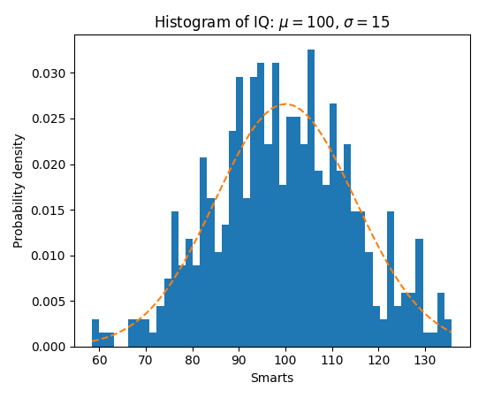

# Progress update template

This example shows how to write progress updates as documentation pages.
See [Progress updates](../../progress-updates.md) for presentation controls.

---

## Formatting


Use ordinary Markdown for emphasis, lists, links and quotations.

- **Bold** uses `**Bold**`. *Italic* uses `*italic*`.
- Inline code such as `index_set` uses backticks.
- [BONDI documentation](https://relaxed-constraints.github.io/bondi/) uses `[text](URL)`.

> Put `>` before a paragraph to make a quotation.

Use one `#` page title, `##` section headings and `###` subheadings.
A line containing `---` separates presentation sections.

---

## Code blocks

Use three backticks and a language name for syntax highlighting:

````markdown
```python
from bondi.mongodb import MongoCollectionRef

target = MongoCollectionRef("bondi_demo", "electric_vehicles")
print(target.database)
```
````

```python
from bondi.mongodb import MongoCollectionRef

target = MongoCollectionRef("bondi_demo", "electric_vehicles")
print(target.database)
```

---

## Images

```markdown

```


Paths are relative to this Markdown file. Keep images alongside the update.
Click the image in the documentation to enlarge it.

---

## Inline math

Wrap a formula in single dollar signs:

```markdown
The sample mean is $\bar{x}$ and the standard deviation is $\sigma$.
```

The sample mean is $\bar{x}$ and the standard deviation is $\sigma$.

```markdown
For query times $t_1, \ldots, t_n$, the mean is $\bar{t}$.
```

For query times $t_1, \ldots, t_n$, the mean is $\bar{t}$.

The shared documentation configuration renders equations.

---

## Block equations

Use double dollar signs for a centred, standalone equation:

```latex
$$
\text{speedup} = \frac{T_{\text{baseline}}}{T_{\text{candidate}}}
$$
```

$$
\text{speedup} = \frac{T_{\text{baseline}}}{T_{\text{candidate}}}
$$

For example, $600\,\text{ms} / 200\,\text{ms} = 3$:
the candidate is **3 times as fast**. These are illustrative values.

---

## Tables

Use pipes for columns. `---:` right-aligns a numeric column.

```markdown
| Index set | Time (ms) | Speedup |
| :-------- | --------: | ------: |
| Baseline  |       600 |    1.0x |
| Single    |       200 |    3.0x |
```

| Index set | Time (ms) | Speedup |
| :-------- | --------: | ------: |
| Baseline  |       600 |    1.0x |
| Single    |       200 |    3.0x |

**Illustrative values only**, not measured BONDI results.

---

## Your progress update

Replace the examples with a short account of your own work, for example:

1. **Question:** What were you trying to achieve?
2. **Progress:** What did you complete since the last meeting?
3. **Results:** Show charts or tables to explain your findings.
4. **Blockers:** What is unclear, and what feedback do you need?
5. **Next steps:** What will you do before the next meeting?

Keep each section focused. Copy this file and its images to a new weekly folder,
then add the page to `nav` in `mkdocs.yml`.

<!-- Presenter note: Ask which next experiment would be most informative. -->

---

## More examples

See the [shared presentation guide](https://relaxed-constraints.github.io/relcon-docs/presentation/)
for presentation controls and configuration.
